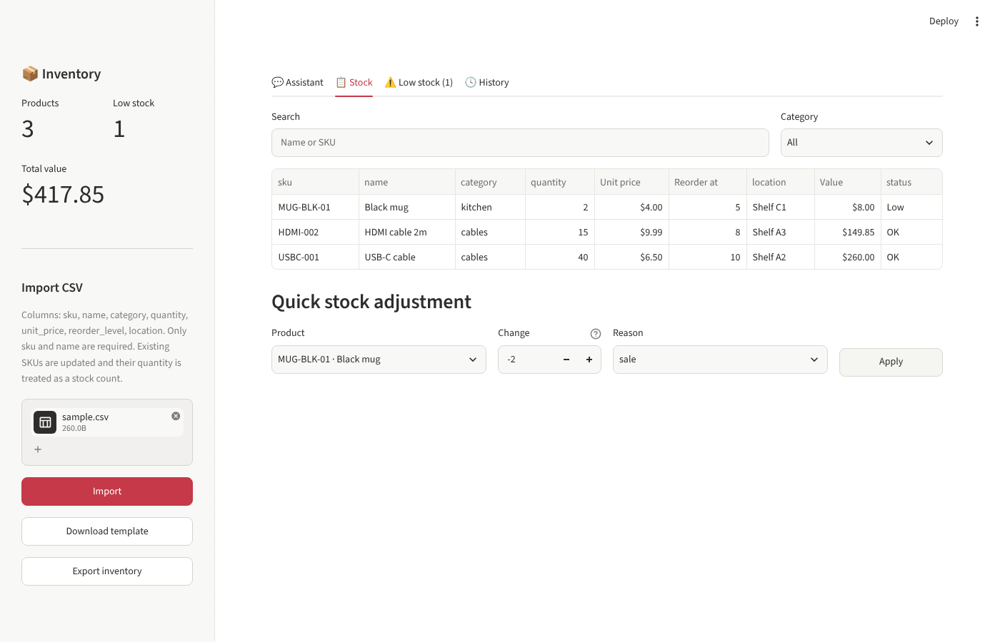

# Inventory Assistant

Manage a small business's inventory in plain English. An AI agent built with LangChain reads and updates a SQLite database through a set of tools, and a Streamlit web app shows your stock, low-stock alerts, and a full change history.



## Features

- **Chat assistant:** "we sold 12 USB-C cables", "what's running low?", "what's my stock worth?"
- **Stock table** with search, category filter, and a quick adjustment form
- **Low-stock report** with suggested order quantities
- **History** of every stock change, with timestamp and reason
- **CSV import and export**, with row-level validation

## Guardrails

- The agent looks products up instead of guessing SKUs and never invents numbers
- Stock can't go negative (checked in code and by a database constraint)
- Every change needs a reason and is logged
- Deletes require confirmation

## Run it

```bash
pip install -r requirements.txt
export ANTHROPIC_API_KEY=your_key
streamlit run app.py          # web app
python inventory_agent.py     # terminal chat
```

Everything except the chat works without an API key. Try importing `sample_inventory.csv` from the sidebar.

To use a different model, set `INVENTORY_MODEL` (for example `openai:gpt-5.4-mini` after `pip install langchain-openai`). Set `INVENTORY_DB` to change where the database file is stored.

## How it works

`inventory_agent.py` defines eight tools (`add_item`, `adjust_stock`, `update_item`, `search_items`, `low_stock_report`, `inventory_value`, `stock_history`, `delete_item`) as plain Python functions over SQLite, and passes them to LangChain's `create_agent`. The model chooses which tools to call; the tools enforce the rules. `app.py` is the Streamlit front end, sharing the same database.
