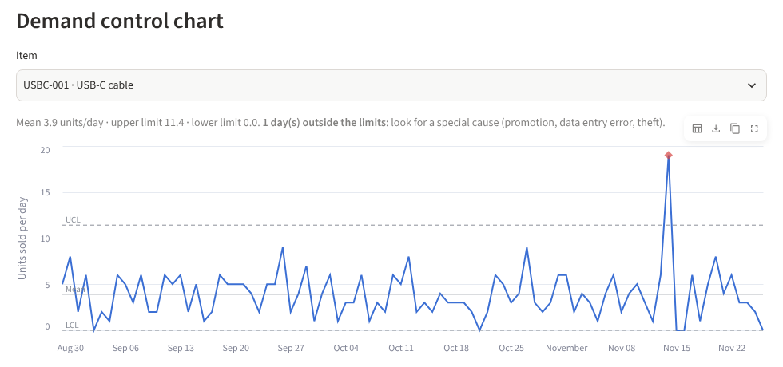

# Inventory Assistant

Manage a small business's inventory in plain English. An AI agent built with LangChain reads and updates a SQLite database through a set of tools, and a Streamlit web app shows your stock, low-stock alerts, and a full change history.


## Features

- **Chat assistant:** "we sold 12 USB-C cables", "what's running low?", "what's my stock worth?"
- **Stock table** with search, category filter, and a quick adjustment form
- **Low-stock report** with suggested order quantities
- **History** of every stock change, with timestamp and reason
- **CSV import and export**, with row-level validation
- **Lean / Six Sigma tab:** statistical reorder points, demand control charts, a Pareto chart of count errors, dead stock, inventory turns and stockout days

## Lean / Six Sigma

The movement log already records every sale, receipt and count correction, so the app can measure waste and variation without extra data entry.

| Metric | Method | What it tells you |
|---|---|---|
| Reorder point | avg daily demand × lead time + safety stock, where safety stock = z × σ(daily demand) × √lead time | When to reorder (Lean pull / Kanban), set from real demand instead of a guess |
| Demand control chart | Individuals (I) chart, limits = mean ± 3σ with σ = average moving range ÷ 1.128 | Whether a spike is normal noise or a special cause worth investigating |
| Count errors per 100 moves | count corrections ÷ all movements | Inventory record accuracy; each correction is a defect |
| Pareto of count errors | units corrected by SKU, sorted, with cumulative % | The few items causing most of the errors |
| Dead stock | stock on hand with no sale in 60 days | Overstock waste tying up cash and space |
| Turns per year | annualized units sold ÷ average units on hand | How hard inventory is working |

Lead time and service level (90% to 99%) are adjustable in the tab, and one click applies the suggested reorder points.



To try it with realistic history, load 90 days of demo data (this replaces the current database):

```bash
python seed_demo.py --reset
```

## Guardrails

- The agent looks products up instead of guessing SKUs and never invents numbers
- Stock can't go negative (checked in code and by a database constraint)
- Every change needs a reason and is logged
- Deletes require confirmation

## Run it

```bash
pip install -r requirements.txt
export ANTHROPIC_API_KEY=your_key
streamlit run app.py          # web app
python inventory_agent.py     # terminal chat
```

Everything except the chat works without an API key. Try importing `sample_inventory.csv` from the sidebar.

To use a different model, set `INVENTORY_MODEL` (for example `openai:gpt-5.4-mini` after `pip install langchain-openai`). Set `INVENTORY_DB` to change where the database file is stored.

## How it works

`inventory_agent.py` defines eight tools (`add_item`, `adjust_stock`, `update_item`, `search_items`, `low_stock_report`, `inventory_value`, `stock_history`, `delete_item`) as plain Python functions over SQLite, and passes them to LangChain's `create_agent`. The model chooses which tools to call; the tools enforce the rules. `app.py` is the Streamlit front end, sharing the same database.
